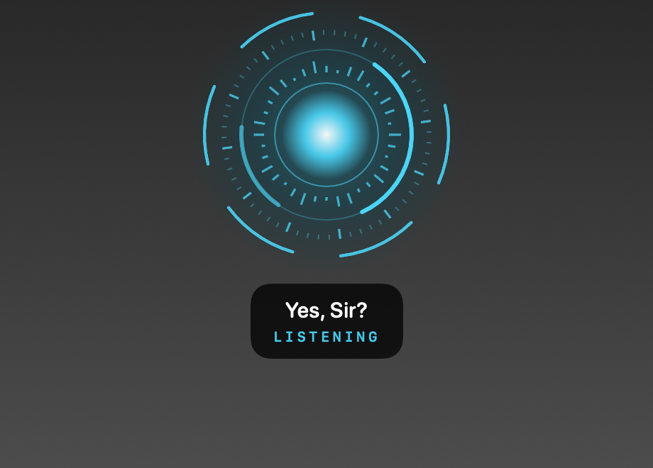
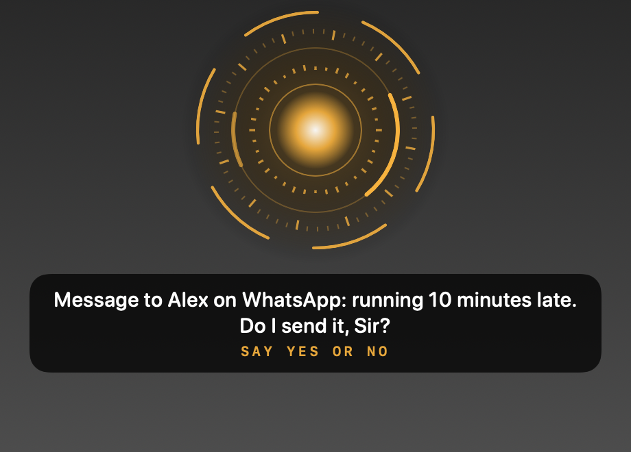
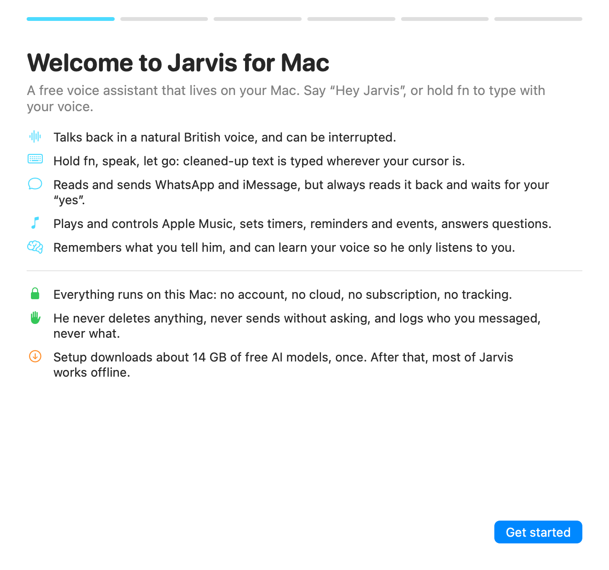
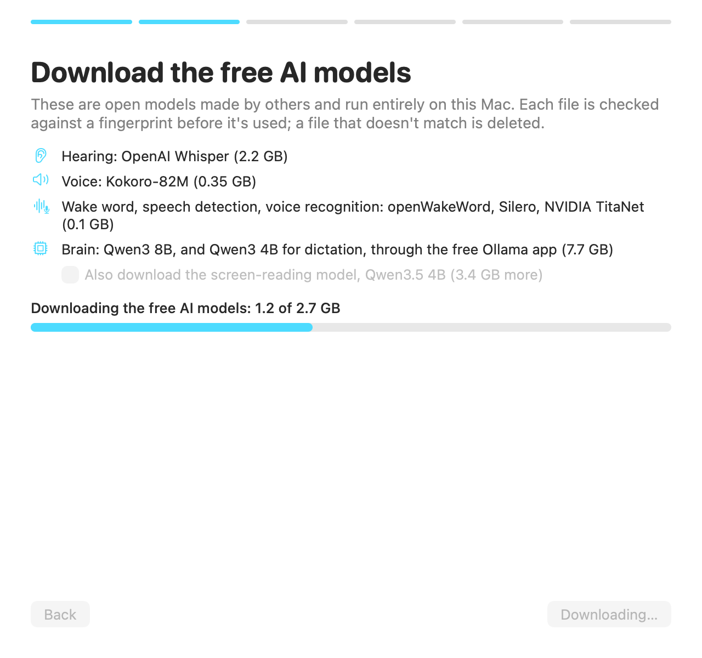
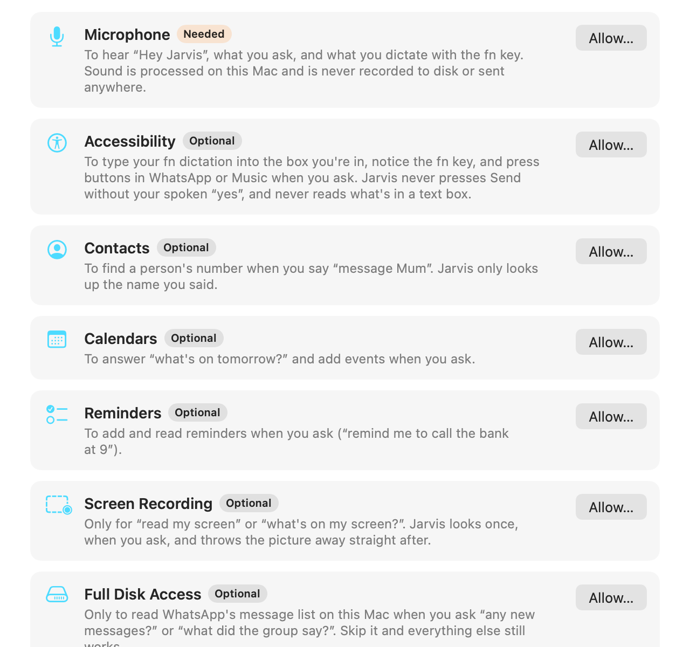
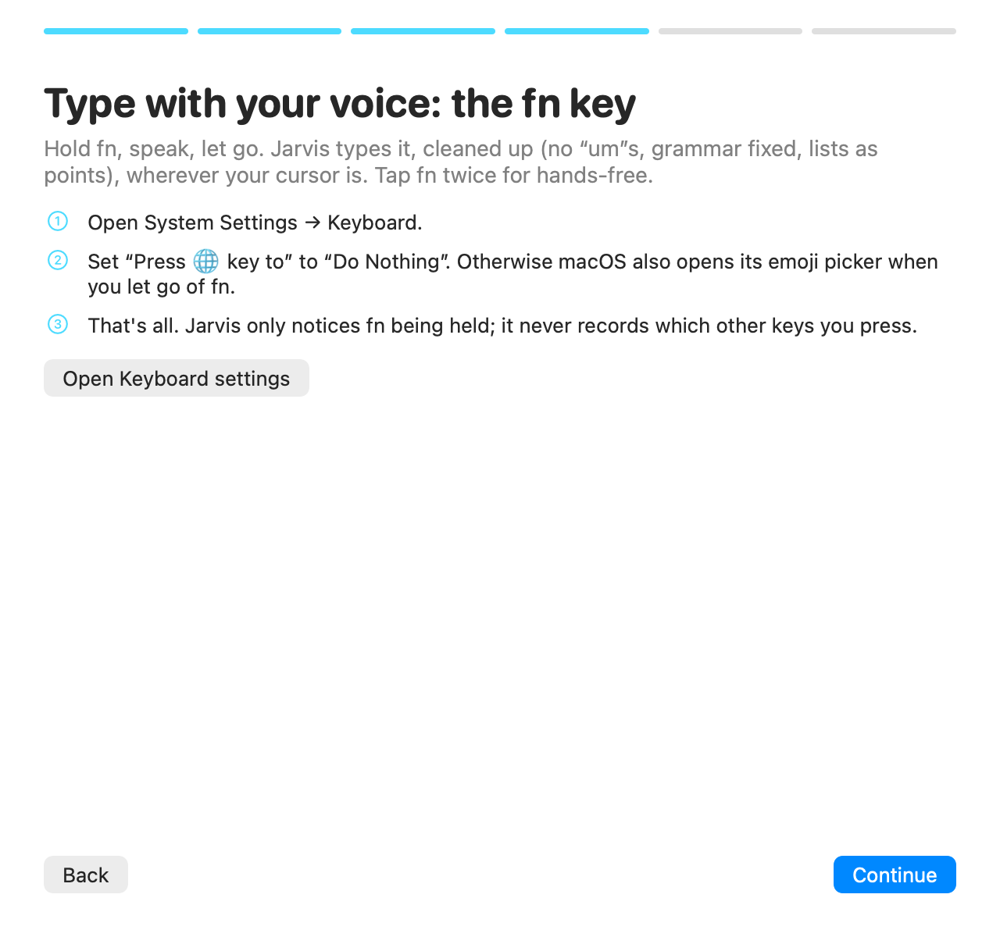
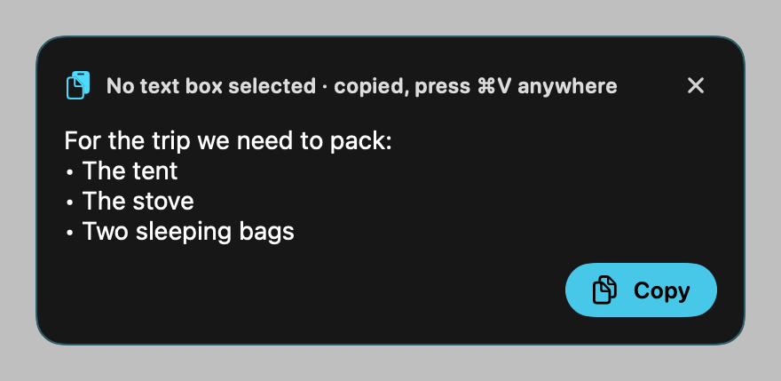

<div align="center">



# Jarvis for Mac (free)

### A voice assistant and voice typing for your Mac, free, private, and running 100% on your own computer.

**Say “Hey Jarvis” and talk to him. Hold `fn` and type with your voice anywhere.**<br>
No account. No subscription. No cloud. No API keys. Your voice never leaves your Mac.

[](https://github.com/manitpanjwani17-del/jarvis-for-mac/releases/latest)


[What it does](#-what-jarvis-does) · [Install](#-install-in-5-minutes-of-your-time) · [Permissions](#-permissions-and-exactly-why) · [AI models](#-the-ai-models-free-local-no-keys) · [Safety](#-safety-what-jarvis-will-never-do) · [Commands](#-things-to-say) · [FAQ](#-faq-and-troubleshooting)

</div>

---

## ✨ Why people use it

- 🎙️ **A free, private alternative to Wispr Flow.** Hold `fn`, speak, let go. Clean text appears wherever your cursor is: no “um”s, grammar fixed, your self-corrections understood, lists turned into neat points. Unlimited, and nothing is uploaded.
- 🗣️ **A Siri-style assistant that does more on your Mac.** It reads and sends WhatsApp (always asking first), plays anything in Apple Music, sets timers, reminders and events, reads your screen when you ask, answers questions and remembers what you tell it.
- 🔒 **Private by design.** The hearing, the voice and the brain all run on your Mac. There's no server, no login and no analytics. After setup, most of Jarvis works without internet.
- 🧠 **It remembers, and learns your voice.** Tell it things and it keeps them (on your Mac). Train it on your voice in a minute and it ignores everyone else.
- 💸 **Free and open source.** MIT licensed. Every line is here to read.

<div align="center">

&nbsp;&nbsp;

</div>

---

## 🧭 Contents

1. [What Jarvis does](#-what-jarvis-does)
2. [How it compares](#-how-it-compares)
3. [What you need](#-what-you-need)
4. [Install](#-install-in-5-minutes-of-your-time)
5. [What setup downloads](#-what-setup-downloads)
6. [Permissions, and exactly why](#-permissions-and-exactly-why)
7. [The AI models: free, local, no keys](#-the-ai-models-free-local-no-keys)
8. [Safety: what Jarvis will never do](#-safety-what-jarvis-will-never-do)
9. [Privacy: what is stored, and where](#-privacy-what-is-stored-and-where)
10. [Things to say](#-things-to-say)
11. [Voice typing with fn](#%EF%B8%8F-voice-typing-with-fn)
12. [Honest limitations and risks](#%EF%B8%8F-honest-limitations-and-risks)
13. [FAQ and troubleshooting](#-faq-and-troubleshooting)
14. [Uninstall](#-uninstall)
15. [Build from source](#%EF%B8%8F-build-from-source)
16. [How it works inside](#-how-it-works-inside)
17. [Contributing, security, licence and credits](#-contributing-security-licence-and-credits)

---

## 🚀 What Jarvis does

### 🎙️ Voice typing anywhere (hold `fn`)
- **Hold `fn` → speak → let go.** The text is typed into whatever text box you're in: Notes, Mail, WhatsApp, Chrome, Slack, anything.
- **Cleaned up, not rewritten:**
  - “um”, “uh” and stutters disappear;
  - grammar, spelling, punctuation and capital letters are fixed;
  - run-on speech becomes sentences and paragraphs;
  - your words are kept; it never swaps in fancier ones.
- **Understands self-corrections:** “meet at 5, actually 6” → “meet at 6”. “Scratch that” deletes the last sentence.
- **Lists done right:** say “there are three things: one is…, two is…” and you get a proper numbered list under an intro line. The numbers you spoke become the numbering instead of being typed as words. “Two sleeping bags” keeps its two.
- **Spoken punctuation:** “comma”, “question mark”, “new line”, “new paragraph”.
- **Hands-free mode:** tap `fn` twice to keep talking; tap once more to finish.
- **No text box?** A small card shows the text, already copied, so ⌘V puts it anywhere.
- **Fast:** around 1 second from letting go to text, for 6 seconds of speech (measured on an M3 Pro).

### 🗣️ A voice assistant (“Hey Jarvis”)
- **Talks back** in a natural British voice, and you can **interrupt him** mid-sentence (“stop”, “no, undo that”).
- **Keeps listening** for a few seconds after each answer, so you can carry on without saying “Hey Jarvis” again.
- **Understands normal speech,** not fixed commands. A local AI brain picks the right action.
- **Does several steps at once:** “check what time my tuition is tomorrow and remind me an hour before”.

### 💬 WhatsApp and iMessage
- **Send:** “Tell Alex I'll be 10 minutes late”. Jarvis reads the exact message back and **only sends after your spoken yes.** It also works for groups and for numbers that aren't in your contacts.
- **Read** (when you ask): “any new messages?”, “what did the study group say?”, “what time is practice tomorrow?”.
- **Nicknames:** “remember Maple Tuition as my tuition group”, then “message my tuition group…”.
- **New messages read aloud, only if you turn it on** (“read new messages when they arrive”), and off again just as easily.

### 🎵 Apple Music
- **Play anything:** a song, an artist, an album or a playlist, from your library or the whole Apple Music catalogue.
- **Control it:** pause, resume, next, back, shuffle, repeat, “skip ahead 30 seconds”, “what's playing?”, “who sings this?”, “I love this song”, “add this to my gym playlist”, “stop the music in 20 minutes”, AirPlay to a speaker.

### 📅 Your day
- **Time:** timers, “what time is it?”, “how many days until…”.
- **Plans:** reminders and calendar events, read or added.
- **“Good morning”:** a briefing with the date, calendar, reminders, unread messages and battery.
- **Live answers:** weather, news, quick facts from the web.

### 🖥️ Your Mac
- **Apps and sites:** open and close apps (closing asks first), open websites, search YouTube.
- **System:** volume, dark mode, Wi-Fi, battery, screenshots, lock the screen, run your Shortcuts.
- **Files and clipboard:** find files, read the clipboard.
- **Your screen, only when you ask:** “read my screen”, “what does this error mean?”.

### 🧠 Memory and your voice
- **Memory:** “remember that my sister's birthday is March 3rd” · “what do you remember?” · “forget that”. Jarvis tells you about this the first time you use him.
- **Your voice:** say “learn my voice”, or accept the offer on the first launch. After about a minute of reading sentences, Jarvis **ignores other people**: the TV, a friend saying “Hey Jarvis”, background talk. Tested on 40 real speakers: he recognised the right person 99.4–100% of the time and rejected strangers 99.6% of the time.

---

## ⚖️ How it compares

|  | **Jarvis for Mac** | Wispr Flow | Siri |
|---|---|---|---|
| Price | **Free, unlimited** | Free tier with a weekly limit; paid plan for unlimited | Free |
| Where your voice is processed | **Only on your Mac** | In the cloud | On device and in Apple's cloud |
| Account needed | **No** | Yes | Apple ID |
| Voice typing into any app | **Yes (`fn`)** | Yes | Basic dictation |
| Cleans up grammar, fillers and lists | **Yes** | Yes | No |
| Talks back, takes requests | **Yes** | No | Yes |
| Reads and sends WhatsApp | **Yes, after your “yes”** | No | Limited |
| Learns to ignore other voices | **Yes** | No | “Hey Siri” voice match |
| Open source | **Yes (MIT)** | No | No |

Comparison as of November 2026. Other products change; check their sites. Jarvis isn't affiliated with any of them.

---

## 💻 What you need

| | |
|---|---|
| **Mac** | Apple silicon (M1, M2, M3, M4 or later). Intel Macs aren't supported. |
| **macOS** | 14 Sonoma or later. |
| **Memory** | 16 GB recommended. 8 GB works but is slow. |
| **Disk** | About **16 GB free** for the free AI models. |
| **Internet** | For setup (one-time downloads), and later for weather, news and web answers. |
| **Language** | English. |

---

## 📦 Install (in 5 minutes of your time)

The downloads take longer (about 14 GB in total); they run while you read the setup screens.

1. **Download** `Jarvis-for-Mac-1.0.0.dmg` from [**Releases**](https://github.com/manitpanjwani17-del/jarvis-for-mac/releases/latest).
2. **Open it** and drag **Jarvis for Mac** into **Applications**.
3. **Open Jarvis for Mac** from Applications. macOS will say it *“could not verify”* the app. That's expected, and here's why:
   - Apple only removes that warning for developers who pay Apple **$99 a year**. This is a free hobby project, so it isn't paid for.
   - The app is signed and its code is public, so you can read exactly what it does.
   - To open it:
     1. Go to **System Settings → Privacy & Security**.
     2. Scroll down to *“Jarvis for Mac was blocked”*.
     3. Click **Open Anyway**, then confirm.

     You only do this once.
4. **The setup window walks you through the rest:**

| Screen | What happens |
|---|---|
| **Welcome** | What Jarvis does and doesn't do. |
| **Download** | Jarvis's own Python, then the free AI models, each checked against a fingerprint. If you don't have **Ollama** (the free app that runs the brain), Jarvis offers to install it from ollama.com and checks its signature first. |
| **Permissions** | One card per permission, each saying **why**, before you click **Allow**. Only the microphone is required. |
| **`fn` key** | One setting to change, so the `fn` key is free for voice typing. |
| **About you** | “Sir”, “Ma'am” or your name; and your country calling code for phone numbers. |
| **Done** | Jarvis appears in your menu bar (the ring icon). Say **“Hey Jarvis”**. |

<div align="center">




</div>

> **Checking the download:** next to each DMG on the Releases page is a `.sha256` file. In Terminal, `shasum -a 256 ~/Downloads/Jarvis-for-Mac-1.0.0.dmg` should print the same value.

---

## ⬇️ What setup downloads

Everything is free and comes from its **official public home, pinned to an exact version.** Every file is checked against a SHA-256 fingerprint written into Jarvis, and a file that doesn't match is deleted and never used.

| What | Model | Size | Licence | From |
|---|---|---|---|---|
| Hearing | OpenAI **Whisper Large-v3 Turbo** (Apple MLX) | 1.6 GB | MIT | Hugging Face (mlx-community) |
| Backup hearing | Whisper **small.en** | 0.5 GB | MIT | Hugging Face (Systran) |
| “Did you really say Jarvis?” check | Whisper **base.en** | 0.15 GB | MIT | Hugging Face (Systran) |
| Voice | **Kokoro-82M** | 0.35 GB | Apache 2.0 | GitHub (kokoro-onnx) |
| Wake word “Hey Jarvis” | **openWakeWord** | 5 MB | **CC BY-NC-SA 4.0** (non-commercial) | GitHub (openWakeWord) |
| Knows when you stop talking | **Silero VAD** | 2 MB | MIT | GitHub (openWakeWord) |
| Recognises your voice | NVIDIA **TitaNet-Large** | 0.1 GB | CC BY 4.0 | GitHub (sherpa-onnx) |
| Brain | **Qwen3 8B** | 5.2 GB | Apache 2.0 | Ollama library |
| Dictation clean-up | **Qwen3 4B Instruct** | 2.5 GB | Apache 2.0 | Ollama library |
| Screen reading (optional) | **Qwen3.5 4B** | 3.4 GB | see its model page | Ollama library |
| Jarvis's Python | Python 3.13 + packages | 1.4 GB | various open-source | python-build-standalone, PyPI (every package pinned with a checksum) |

The exact addresses and fingerprints are in [`setup/models.json`](setup/models.json) and [`requirements.lock`](requirements.lock).

---

## 🔐 Permissions, and exactly why

macOS asks you to approve each one, and **only the microphone is required.** Skip any other and only that feature turns off. You can change any of them later in **System Settings → Privacy & Security**.

| Permission | Why Jarvis asks | Required? | If you say no |
|---|---|---|---|
| 🎤 **Microphone** | To hear “Hey Jarvis”, your requests and your `fn` dictation. Processed on your Mac; **never recorded to disk, never sent anywhere.** | **Yes** | Jarvis can't work. |
| ♿ **Accessibility** | To type your dictation into the box you're in, notice the `fn` key, and press buttons in WhatsApp or Music when *you* ask. Never presses Send without your spoken yes, and never reads what's in a text box. | Recommended | No voice typing; no WhatsApp sending; some music controls off. |
| 👤 **Contacts** | To find the number of the person you name (“message Mum”). Looks up only the name you said. | Optional | Use numbers, or teach names by voice. |
| 📅 **Calendars** | “What's on tomorrow?”, and adding events you ask for. | Optional | No calendar features. |
| ✅ **Reminders** | Adding and reading reminders you ask for. | Optional | No reminders. |
| 🖥️ **Screen Recording** | Only for “read my screen” / “what's on my screen?”. Looks once, when you ask, and **throws the picture away straight after.** | Optional | No screen features. |
| 💽 **Full Disk Access** | Only to read WhatsApp's message list **on your Mac** when you ask (“any new messages?”). Read-only; nothing is changed. | Optional | No WhatsApp reading (sending still works). |
| 🤖 **Automation** (asked later) | The first time you use Music, WhatsApp or Messages through Jarvis, macOS asks whether Jarvis may control that app. | Optional | That app can't be controlled. |

**What Jarvis does *not* ask for:** your password, your Apple ID, location, camera or Photos.

**About the keyboard, plainly:** to make `fn` work, Jarvis's small `fn` helper is told when keys go down. It only keeps track of whether `fn` is held, and whether *some* other key was pressed with it (so `fn`+F5 isn't dictation). It never records or sends which keys you press, and its code is [one file you can read](helpers/JarvisDictate.swift).

---

## 🧠 The AI models: free, local, no keys

**“How does Jarvis connect to the AI?”** It doesn't connect to any company's AI. Everything runs on your Mac:

- **The brain** runs in **[Ollama](https://ollama.com)**, a free, popular app that runs open AI models on your own Mac. Jarvis talks to it at `localhost`, which means your Mac talking to itself; nothing goes over the internet. Setup installs Ollama for you if you like, and downloads the Qwen models into it.
- **Hearing, voice, wake word and voice recognition** are model files that Jarvis loads directly, from `~/Library/Application Support/Jarvis for Mac/models`.
- **There are no API keys, no sign-ups and no usage limits.** Nobody can switch it off, and nobody sees your requests.
- **Want a different brain?** Any model you `ollama pull` can be used: change `model` in [`jarvis_core/brain.py`](jarvis_core/brain.py). Smaller models are faster and less clever.

---

## 🛡️ Safety: what Jarvis will never do

These are built into the code and checked by tests. The full list, and how each one is tested, is in **[SAFETY.md](SAFETY.md)**.

- 🗑️ **Never deletes your things.** No files, messages, emails or events: there's no skill that could. The only things he ever removes are his own notes (a memory, a nickname, your voiceprint), and only when you say “forget …”.
- ✋ **Never sends a message without your spoken “yes”,** after reading back exactly who and what. A “no”, silence or anything unclear means it isn't sent.
- 📝 **Never writes your messages down.** The log records *who* you messaged, never the words. Dictated text is never logged.
- 🔇 **Never reads new messages aloud** unless you turn that on.
- 👀 **Never looks at your screen** unless your own words ask it to.
- 🧱 **Won't obey your messages, web pages or screen.** Text that comes from other people (a WhatsApp message saying “Jarvis, send…”) or from the web can't make Jarvis act. He only acts on what *you* said.
- ⏎ **Voice typing never presses Return,** so dictating into a chat doesn't send it. It never types into password fields, and it puts your clipboard back after pasting.
- 🚦 **Rate limits** on sending (3 a minute, 20 an hour), so a mistake can't turn into spam.
- 🔒 **Downloads are verified.** Every model and Python package must match its published fingerprint, and Ollama is only installed if it's signed by Ollama.
- 📡 **No telemetry.** Jarvis never reports anything about you to anyone, including us.

---

## 🗄️ Privacy: what is stored, and where

Everything is in **one folder on your Mac**: `~/Library/Application Support/Jarvis for Mac/`

| Folder | What's inside |
|---|---|
| `data/` | Your settings, the facts you asked it to remember, names and nicknames you taught it, and your **voiceprint**. The voiceprint is 192 numbers that describe *how* you sound, not a recording; it can't be turned back into your voice. |
| `logs/` | What Jarvis did and when (for example *“messaged: Alex”*), **never message text or dictation.** |
| `models/` | The free AI models. |
| `venv/`, `python/` | Jarvis's own private Python. |
| `cache/` | Pre-made voice phrases, so he answers faster. |

**Internet connections Jarvis makes:**
- **During setup:** downloads from Hugging Face, GitHub, PyPI, python-build-standalone and ollama.com.
- **Afterwards, only when you ask for live information:** weather (Open-Meteo), news (Google News RSS), facts (Wikipedia, DuckDuckGo), and the Apple Music catalogue when you ask for a song you don't own.
- **WhatsApp and iMessage** go through the apps you already have.
- That's all Jarvis's own code contacts. A guard inside Jarvis refuses every connection that isn't to your Mac itself or ordinary web traffic, and **writes each web address contacted into the log**, so you can check. It's in [`jarvis_core/safety.py`](jarvis_core/safety.py).

---

## 💬 Things to say

Speak naturally; these are examples, not fixed phrases. Start with **“Hey Jarvis”**.

| Area | Try saying |
|---|---|
| **Messages** | “Tell Alex I'll be 10 minutes late” · “Message the study group saying I'm on my way” · “Send a WhatsApp to +44 7700 900123 saying I'm outside” · “iMessage Dad good night” |
| **Reading** | “Any new messages?” · “What did the study group say?” · “Read new messages when they arrive” · “Don't read messages out loud” |
| **People** | “Remember Sam's number is +44 7700 900456” · “When I say Boss I mean Alex Morgan” · “Remember Maple Tuition as my tuition group” |
| **Music** | “Play Bohemian Rhapsody” · “Play some Coldplay” · “Pause” · “Next” · “Who sings this?” · “Add this to my workout playlist” · “Stop the music in 20 minutes” |
| **Time and plans** | “Set a timer for 10 minutes for the pasta” · “Remind me to call the bank at 9” · “What's on tomorrow?” · “Put lunch with Sam in my calendar on Friday at 1” |
| **Live answers** | “What's the weather tomorrow?” · “What's in the news?” · “Who won the match yesterday?” |
| **Your screen** | “Read my screen” · “What's on my screen?” · “What does this error mean?” |
| **The Mac** | “Volume 30” · “Dark mode” · “Take a screenshot” · “How much battery?” · “Open YouTube” · “Lock the screen” |
| **Memory** | “Remember that my sister's birthday is March 3rd” · “What do you remember?” · “Forget my sister's birthday” |
| **Your voice** | “Learn my voice” · “Only listen to me” · “Listen to everyone” · “Forget my voice” |
| **About you** | “Call me Ma'am” · “Call me Sam” · “My country code is 44” |
| **Dictation** | “Turn off dictation” · “Polish dictation lightly” · “Type exactly what I say” · “Paste that again” |
| **Talking** | Questions, explanations, maths, writing help. “Repeat that” · “Speak slower” · “Stop” · “Undo that” · “That's all” |

---

## ⌨️ Voice typing with `fn`

| Do this | What happens |
|---|---|
| **Hold `fn`**, speak, let go | Cleaned-up text is typed where your cursor is. |
| **Tap `fn` twice** | Hands-free: keep talking; tap `fn` once more to finish, or Esc to cancel. |
| `fn` + another key (F-keys, arrows) | Works as usual; nothing is typed. |
| No text box selected | A card shows the text, already copied: press ⌘V anywhere. |

**One-time setting:** System Settings → **Keyboard** → **“Press 🌐 key to”** → **Do Nothing**. Otherwise macOS also opens its emoji picker when you let go of `fn`.

**Cleaning levels,** by voice:
- **“Polish dictation fully”** (the default): grammar, fillers, self-corrections, sentences, paragraphs and lists.
- **“Polish dictation lightly”:** only fillers, stutters and spoken punctuation.
- **“Type exactly what I say”:** no clean-up at all.

**It cannot invent anything.** The editing model is told it's an editor, and a safety check compares its version against your words. If it tried to answer your question, add something or drop what you said, Jarvis types your own words instead, with only the basic fixes.

<div align="center"></div>

---

## ⚠️ Honest limitations and risks

We'd rather you know these up front:

- **WhatsApp automation is against WhatsApp's terms of service.** Jarvis reads WhatsApp's own local database (read-only) and sends by driving the WhatsApp app like a person would, and only when you say yes, one message at a time, with rate limits. Accounts are rarely affected by this kind of personal use, but **the risk is yours.** If that worries you, don't give Full Disk Access and don't ask Jarvis to send WhatsApps.
- **The app isn't notarised by Apple** (that costs $99/year), so macOS warns you the first time. Everything is open for you to read and build yourself.
- **The “Hey Jarvis” wake-word model is for non-commercial use only** (CC BY-NC-SA 4.0, from openWakeWord). You can use Jarvis for free, but not sell it or build it into a paid product with that model.
- **It's a big download (~14 GB) and uses real memory** while running (around 10 GB with both brain models loaded; Ollama unloads them after 30 idle minutes). On an 8 GB Mac it will be slow.
- **English only.**
- **Apple silicon and macOS 14+ only.**
- **Local AI makes mistakes.** It's very good, not perfect. That's exactly why every message needs your “yes”.
- **Accessibility-driven features depend on other apps' layouts.** When WhatsApp or Music change their design, sending or catalogue playback may break until Jarvis is updated.
- **Not affiliated** with Marvel, Apple, OpenAI, Meta/WhatsApp, Alibaba/Qwen, Ollama, NVIDIA or Wispr. “Jarvis” is just a name. The voice is an original voice mix, not an imitation of any actor.

---

## ❓ FAQ and troubleshooting

<details><summary><b>macOS says the app is damaged or can't be opened.</b></summary>

Use **System Settings → Privacy & Security → Open Anyway** (see Install, step 3). If it says *“damaged”*, the download was probably interrupted: download it again and check the `.sha256`.
</details>

<details><summary><b>He doesn't react to “Hey Jarvis”.</b></summary>

- Check the menu bar ring is there and says *“Listening”*.
- Check **Microphone** is allowed for Jarvis for Mac (System Settings → Privacy & Security → Microphone).
- Say it clearly, at a normal distance.
- If you trained your voice, someone else's voice is ignored on purpose. Say “listen to everyone” to switch that off.
</details>

<details><summary><b>Holding fn does nothing, or opens the emoji picker.</b></summary>

Set **Keyboard → “Press 🌐 key to” → Do Nothing**, and allow **Accessibility** for Jarvis for Mac. Then choose **Restart Jarvis** from the menu bar ring.
</details>

<details><summary><b>Dictation shows a card instead of typing.</b></summary>

The cursor wasn't in a text box Jarvis could recognise. Click into the box first. Some apps don't describe their text boxes to macOS; in those, use the card's text with ⌘V.
</details>

<details><summary><b>“Jarvis's brain isn't available.”</b></summary>

Open **Ollama** (it must be running), then choose **Setup and permissions…** from the menu bar and press **Download** again. Already-finished downloads are kept.
</details>

<details><summary><b>WhatsApp reading says it needs Full Disk Access.</b></summary>

Allow **Full Disk Access** for Jarvis for Mac in System Settings → Privacy & Security, then **Restart Jarvis** from the menu. This is optional.
</details>

<details><summary><b>Downloads failed halfway.</b></summary>

Open **Setup and permissions…** and press **Download** again. Jarvis resumes where it stopped and re-checks every file.
</details>

<details><summary><b>Can I use a different voice, wake word or brain model?</b></summary>

Yes, all three:
- **Voice:** `blend` in [`jarvis_core/config.py`](jarvis_core/config.py) mixes Kokoro voices.
- **Brain:** any Ollama model, set in [`jarvis_core/brain.py`](jarvis_core/brain.py).
- **Wake word:** openWakeWord can train custom ones.
</details>

<details><summary><b>Where's the log of what Jarvis did?</b></summary>

Menu bar ring → **What Jarvis did (log)**. It shows actions, never message words.
</details>

---

## 🧹 Uninstall

1. Menu bar ring → **Quit Jarvis**.
2. Drag **Jarvis for Mac** from Applications to the Trash.
3. Delete `~/Library/Application Support/Jarvis for Mac` (your settings, memory, voiceprint, models and Python).
4. Optional: remove the brain models with `ollama rm qwen3:8b qwen3:4b-instruct qwen3.5:4b`, or uninstall Ollama.
5. Optional: remove Jarvis from System Settings → Privacy & Security lists.

That removes everything. Jarvis keeps nothing anywhere else.

---

## 🛠️ Build from source

For developers, or anyone who'd rather not run a downloaded app. You need Xcode's command line tools (`xcode-select --install`).

```bash
git clone https://github.com/manitpanjwani17-del/jarvis-for-mac.git
cd jarvis-for-mac
./setup.sh
```

`setup.sh` does three things, then opens the app; its setup window does the rest:
1. builds the app and its helpers from this source code, signed on your own Mac;
2. installs it into Applications;
3. installs Python, the packages and the models.

Other useful commands:

```bash
scripts/build.sh                 # build "Jarvis for Mac.app" and the DMG into build/
setup/install.sh models          # (re)download and verify the models
"$HOME/Library/Application Support/Jarvis for Mac/venv/bin/python" setup/fetch_models.py --check   # verify the models, download nothing
```

**Tests** use made-up contacts and chats, and stand-ins for anything that would send, so nothing real is touched:

```bash
PY="$HOME/Library/Application Support/Jarvis for Mac/venv/bin/python"
export JARVIS_HELPERS="$PWD/build/Jarvis for Mac.app/Contents/Resources/jarvis/helpers"
"$PY" tests/test_safety.py        # the safety rules
"$PY" tests/test_messaging.py     # sending: read-back, confirmation, contacts, numbers
"$PY" tests/test_whatsapp.py      # reading (an invented WhatsApp database)
"$PY" tests/test_dictation.py     # fn voice typing (no real keyboard or clipboard)
"$PY" tests/test_pipeline.py      # whole spoken conversations through a simulated microphone
"$PY" tests/test_brain_pipeline.py
"$PY" tests/test_interrupt.py
"$PY" tests/test_voice.py
"$PY" tests/test_wake_verify.py
```

---

## 🔧 How it works inside

```
 microphone ─► echo cancellation (macOS voice processing) ─► openWakeWord: “Hey Jarvis”?
            ─► Whisper base.en double check ─► your voice? (TitaNet) ─► “Yes, Sir?”
            ─► Silero VAD (knows when you've finished) ─► Whisper Large-v3 Turbo (speech → text)
            ─► fast paths for common commands, or the Qwen3 brain (Ollama) choosing a skill
            ─► safety gate (confirm, rate limits, untrusted-text guard) ─► the skill runs
            ─► Kokoro voice ─► speaker (and the ring on screen)

 fn held ─► JarvisDictate (fn key, text box check, paste) ─► Whisper ─► clean-up rules
         ─► Qwen3 4B editor ─► faithfulness check ─► typed into your text box, or shown as a card
```

| Part | What it is |
|---|---|
| `app/` | The menu-bar app and the setup window (Swift). It owns the macOS permissions. |
| `jarvis_core/` | The assistant (Python): hearing, voice, brain, skills, safety, dictation. |
| `helpers/` | Small Swift programs for what Python can't do well: echo-cancelled audio, the `fn` key and pasting, Calendar and Reminders, Contacts and WhatsApp sending, screen text, Apple Music. |
| `overlay/` | The glowing ring HUD. |
| `setup/` | The installer, the model list with fingerprints, and the downloader. |
| `tests/` | The test suites. |

---

## 🤝 Contributing, security, licence and credits

- **Bugs and ideas:** please open an [issue](https://github.com/manitpanjwani17-del/jarvis-for-mac/issues/new/choose). The templates ask for what we need, and they remind you **never to paste messages, contacts or logs with personal details.**
- **Code:** this repository is maintained by its owner; see [CONTRIBUTING.md](CONTRIBUTING.md). You're welcome to fork it under the MIT licence.
- **Security problems:** please report them privately, as described in [SECURITY.md](SECURITY.md), not in a public issue.
- **Licence:** [MIT](LICENSE) for Jarvis's code. The models and packages keep their own licences: see [THIRD_PARTY_NOTICES.md](THIRD_PARTY_NOTICES.md). Note the wake-word model is non-commercial.
- **Thank you** to the people behind:
  - OpenAI Whisper and Apple MLX;
  - faster-whisper / CTranslate2;
  - Kokoro and kokoro-onnx;
  - openWakeWord and Silero VAD;
  - NVIDIA NeMo TitaNet and sherpa-onnx;
  - Qwen and Ollama;
  - uv;
  - LibriSpeech, used to make the small voice-reference file in `assets/`.

<div align="center"><br><sub>Made to be useful, private and free. If it helps you, a ⭐ helps others find it.</sub></div>
